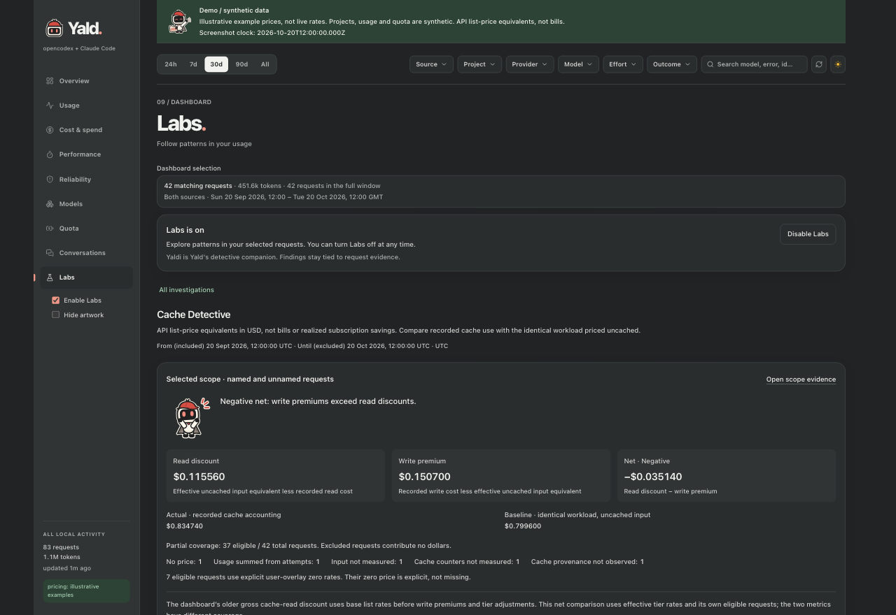
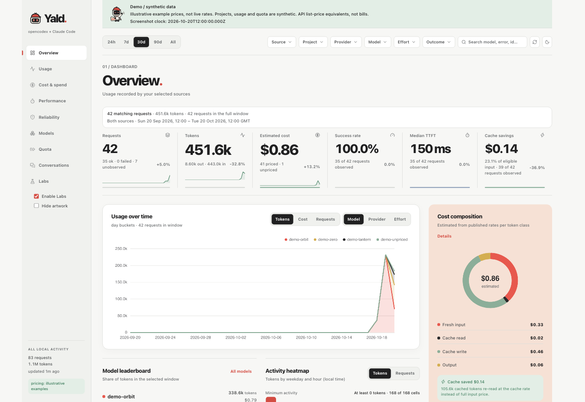

<p align="center">
  
</p>
<h1 align="center">Yald — Yet Another LLM Dashboard</h1>
<p align="center"><strong>Follow the tokens. Find the story.</strong></p>

Yald turns the usage records already on your machine into a desktop dashboard for token volume,
estimated cost, cache use and submitted context.

**Meet Yaldi**, Yald's small detective companion. Yaldi appears in Labs findings and in loading
and empty states, and you can hide the artwork from the sidebar.

Dollar amounts are **API list-price equivalents**: what the same tokens would cost at list price.
They don't reflect your subscription bill and don't prove savings. Missing input or price is
unavailable, not zero or free.

## Install Yald 0.2.0

Yald 0.2.0 ("Meet Yaldi", 2026-10-20) ships as `yald-dashboard-0.2.0.tgz` on the
[v0.2.0 release page](https://github.com/Collaboration95/yald/releases/tag/v0.2.0), next to a
`SHA256SUMS` file. If the page doesn't have the tarball yet, use a
[development checkout](docs/install.md#development-checkout). npm and Homebrew are unverified, so
install from the GitHub tarball. The earlier
[v0.1.0 prerelease](https://github.com/Collaboration95/yald/releases/tag/v0.1.0) is an
opencodex-only preview without Claude ingestion, reports, Yaldi, Labs or demo.

On macOS or Linux, you need Node.js 18+, npm, an authenticated `gh` CLI and `shasum`:

```bash
release_dir="$(mktemp -d)"
yald_prefix="$HOME/.local"
gh release download v0.2.0 --repo Collaboration95/yald \
  --pattern 'yald-dashboard-0.2.0.tgz' --pattern SHA256SUMS --dir "$release_dir"
(cd "$release_dir" && shasum -a 256 -c SHA256SUMS) && \
npm install --global --prefix "$yald_prefix" "$release_dir/yald-dashboard-0.2.0.tgz"
export PATH="$yald_prefix/bin:$PATH"
yald --version
yald --help
yald demo --open
```

`yald --version` should print exactly `0.2.0`. The demo opens **http://127.0.0.1:4318** with
synthetic examples and illustrative prices. Press Ctrl+C to stop it and remove its temporary data,
or run `yald --open` to use your own local sources instead.

Yald leaves your source files untouched. For Claude transcripts it writes its own archive, which has
no automatic expiry (see [Limits and local storage](#limits-and-local-storage)). If you prefer
another user-writable `yald_prefix`, keep its `bin` on `PATH`. More in
[installation, data locations and development setup](docs/install.md).

## What Yald reads

Point Yald at existing opencodex ledgers or Claude Code transcripts. It doesn't collect new model
usage. Pricing needs a discoverable installed opencodex cost engine, including for Claude rows
([exact paths and pricing discovery](docs/install.md#data-locations-and-local-archive)).

| Recorded capability | opencodex (`ocx`) | Claude transcripts (`claude-code`) |
| --- | --- | --- |
| Tokens and cache counters | When recorded | When recorded; subagents included |
| API price equivalent | When usage and price are available | When usage and price are available |
| Outcomes / failures and retries | When observed | Unavailable |
| Duration / time to first token | When measured | Unavailable |
| Quota | Recorded account snapshots | Unavailable |
| Project folder | Joined Codex rollout metadata | Recorded `cwd` |

A source names the ingestion protocol, and the provider can differ: Anthropic traffic through
opencodex stays `ocx`. Sessions are keyed by `(source, conversationId)`. A capability doesn't
guarantee that every row has a measurement
([coverage definitions](docs/metrics.md#source-capabilities-and-measurement-coverage)).

## Ask Yaldi three questions

Turn on **Labs** in the sidebar (it's already on in the demo). Each question has its own view:

- **Project Radar:** Which projects drive activity and priced cost, and what changed
  since the previous window of the same length?
- **Cache Detective:** For the same recorded workload, do cache-read discounts
  outweigh cache-write premiums?
- **Context Replay:** How did the input you submitted grow or shrink within a session?

Each finding opens a **fixed evidence case** with its original window, complete cohort, source
identity, coverage and request metadata. Toolbar changes don't move the case, and Radar keeps both
original periods. See the [investigation guide](docs/guide.md#labs-investigations) and
[case evidence](docs/labs-evidence.md).



*Synthetic example, not measured savings. More [screenshots and the capture procedure](docs/release-candidate-v0.2.0.md#synthetic-screenshots).*

## Try the demo

You don't need personal usage records. In the installed package, run `yald demo --open`. From a
checkout, run `node scripts/yald.mjs demo --open` after
[development setup](docs/install.md#development-checkout). Example prices are illustrative, not live
rates. The [demo guide](docs/demo.md) covers the sample clock and cleanup.



*The installed demo, with synthetic usage and illustrative prices. Overview's "cache savings" is the
gross cache-read discount before write premiums; Cache Detective has the net comparison
([metric definitions](docs/metrics.md#net-cache-economics)).*

## Write a report

`yald report` writes a standalone HTML file and JSON without starting a server:

```bash
yald report --from '2026-10-11 09:00' --to '2026-10-11 18:00' \
  --tz Asia/Singapore --out investigation.html --json
```

Reports redact IDs and home paths by default, so review them before sharing. More
[report examples and window rules](docs/guide.md#reports).

## Limits and local storage

- Source files stay untouched. Yald **writes its own local Claude archive** at
  `$OCX_HOME/yald-claude-usage.jsonl` (default `~/.opencodex/yald-claude-usage.jsonl`) with no
  automatic expiry. An empty transcript folder does **not** remove archived usage, and source
  filters do **not** delete archives. [Archive behavior](docs/install.md#data-locations-and-local-archive).
- Claude transcripts don't measure failures, retries, timing or quota, and a compatibility HTTP 200
  is not evidence of success. [Measurement limits](docs/metrics.md#source-capabilities-and-measurement-coverage).
- Price coverage and project attribution coverage are separate. Unpriced rows still count toward
  activity, and project filters exclude unknown folders and say so.
  [Pricing](docs/metrics.md#metering-and-cost) · [Attribution](docs/metrics.md#project-attribution).
- Quota is account-wide and can be stale while the proxy is stopped. Loaded history may be
  incomplete. The desktop UI makes no claim about productivity, answer quality, compaction or
  cache-miss causes.

[Views and reports](docs/guide.md) · [Metrics](docs/metrics.md) · [API](docs/api.md) ·
[Architecture](docs/architecture.md) · [Contributing](CONTRIBUTORS.md) ·
[Changelog](CHANGELOG.md) · [Release procedure](docs/releasing.md) · [MIT license](LICENSE)
