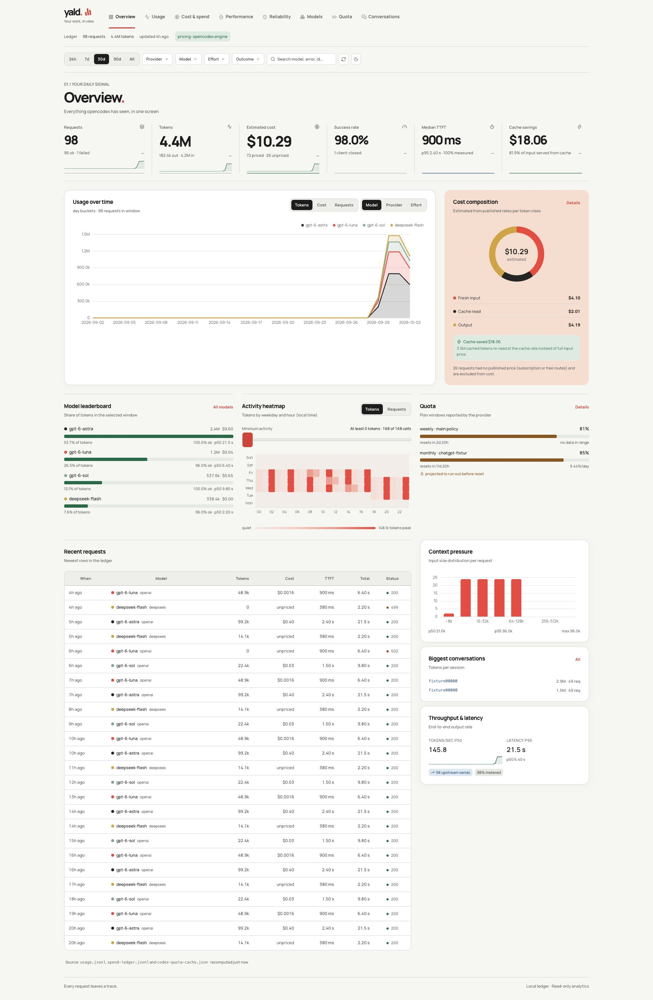

# Yald — Yet Another LLM Dashboard

[](https://github.com/Collaboration95/yald/actions/workflows/ci.yml)

**Follow the tokens. Find the story.** Yald turns local usage records into a
desktop dashboard for investigating token volume, estimated cost, cache use and
submitted context. **Yaldi** is its detective companion in optional Labs.

Dollar amounts are **API list-price equivalents**, not subscription bills or
proof of savings. Missing input or price is unavailable, not zero or free.



*Synthetic preview data. The older Overview's “cache savings” means gross
cache-read discount, before write premiums; see [metric definitions](docs/metrics.md#net-cache-economics).*

## Install the published preview

The current download is the [**v0.1.0 GitHub prerelease**](https://github.com/Collaboration95/yald/releases/tag/v0.1.0).
It includes the opencodex dashboard, built UI and Bun runtime dependency.
**Claude ingestion, reports, Yaldi and Labs are implemented on `dev` for the
planned 0.2.0 release; they are absent from this published preview.**
Registry and Homebrew publication are unverified.

On macOS or Linux, use Node.js 18+, npm, an authenticated `gh` CLI and `shasum`:

```bash
release_dir="$(mktemp -d)"
yald_prefix="$HOME/.local"
gh release download v0.1.0 --repo Collaboration95/yald \
  --pattern 'yald-dashboard-0.1.0.tgz' --pattern SHA256SUMS --dir "$release_dir"
(cd "$release_dir" && shasum -a 256 -c SHA256SUMS) && \
npm install --global --prefix "$yald_prefix" "$release_dir/yald-dashboard-0.1.0.tgz"
export PATH="$yald_prefix/bin:$PATH"
yald --version
yald --help
yald
```

Open **http://127.0.0.1:4318**; stop with Ctrl+C. The version should be `0.1.0`.
Choose another user-writable `yald_prefix` if needed; keep its `bin` on `PATH`.
See [installation, data locations and development setup](docs/install.md).

## Sources and capabilities

The following describes **current development**. Supply existing opencodex
ledgers or Claude Code transcripts; Yald does not collect new model usage.
Pricing needs a discoverable installed opencodex cost engine, including for
Claude rows. [Exact paths and pricing discovery](docs/install.md#data-locations-and-local-archive).

| Recorded capability | opencodex (`ocx`) | Claude transcripts (`claude-code`) |
| --- | --- | --- |
| Tokens and cache counters | When recorded | When recorded; subagents included |
| API price equivalent | When usage and price are available | When usage and price are available |
| Outcomes / failures and retries | When observed | Unavailable |
| Duration / time to first token | When measured | Unavailable |
| Quota | Recorded account snapshots | Unavailable |
| Project folder | Joined Codex rollout metadata | Recorded `cwd` |

**Source is the ingestion protocol, not the provider.** Anthropic traffic through
opencodex remains `ocx`. Sessions use `(source, conversationId)`. Capability does
not guarantee that a row has a measurement. [Coverage definitions](docs/metrics.md#source-capabilities-and-measurement-coverage).

## Three questions for Labs

On `dev`, enable **Labs** in the sidebar:

- **Project Radar:** Which projects account for activity and priced cost, and
  what changed against the immediately preceding equal-duration window?
- **Cache Detective:** For the identical recorded workload, do cache-read
  discounts outweigh cache-write premiums?
- **Context Replay:** How did recorded submitted input change within a
  source-qualified session?

Each finding opens a **fixed evidence case** with its original window, complete
cohort, source identity, coverage and request metadata. Toolbar changes do not
move that case; Radar retains both original periods. [Investigation guide](docs/guide.md#labs-investigations)
and [case evidence](docs/labs-evidence.md).

## One report

Available on `dev`, after [development setup](docs/install.md#development-checkout):

```bash
node scripts/yald.mjs report --from '2026-10-11 09:00' --to '2026-10-11 18:00' \
  --tz Asia/Singapore --out investigation.html --json
```

This writes a standalone HTML file and JSON without starting a server. Reports
redact IDs and home paths by default; review files before sharing. More
[report examples and window rules](docs/guide.md#reports).

## Limits and local storage

- Source files stay untouched. Yald **writes its own local Claude archive** at
  `$OCX_HOME/yald-claude-usage.jsonl` (default
  `~/.opencodex/yald-claude-usage.jsonl`), with no automatic expiry. An empty
  transcript folder does **not** remove archived usage; source filters do **not**
  delete archives. [Archive behavior](docs/install.md#data-locations-and-local-archive).
- Claude transcripts do not measure failures, retries, timing or quota; a
  compatibility HTTP 200 is not evidence of success. [Measurement limits](docs/metrics.md#source-capabilities-and-measurement-coverage).
- Price coverage and project attribution coverage are separate. Unpriced rows
  still count toward activity; project filters exclude unknown folders and
  disclose that exclusion. [Pricing](docs/metrics.md#metering-and-cost) · [Attribution](docs/metrics.md#project-attribution).
- Quota is account-wide and can be stale while the proxy is stopped. Loaded
  history may be incomplete. The desktop UI makes no claim about productivity,
  answer quality, compaction or cache-miss causes.

[Views and reports](docs/guide.md) · [Metrics](docs/metrics.md) · [API](docs/api.md) ·
[Architecture](docs/architecture.md) · [Contributing](CONTRIBUTORS.md) ·
[Changelog](CHANGELOG.md) · [Release procedure](docs/releasing.md) · [MIT license](LICENSE)
