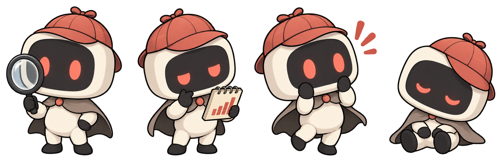

# Yaldi brand assets

The maintainer accepted the **Yaldi** name and robot-detective direction on
2026-10-20. The product stays **Yald**, with the existing `Yald.` wordmark;
Yaldi is its small detective companion.



Yaldi is a compact, friendly robot with a coral detective cap, an ink face panel,
paper-coloured body and magnifying glass. Use the simple mark at small sizes and
the full character for a finding, analysis/loading state, or empty state. Findings
must still identify their evidence and limitations in text: artwork never replaces
essential text, and an error is never shown with the cheerful clue-found art.

- [Production asset and integration contracts](../../planning/epics/03-yaldi-identity.md) (B01 assets, B02 integration)
- [Release plan](../../planning/yaldi-release-plan.md)
- [`manifest.json`](manifest.json): every asset with its path, intrinsic size, theme, alt text and use
- [Application integration](integration.md): component props, hide-artwork setting, actual finding guards and local-asset verification

## Shipped versus reference-only

**Shipped** files live in `web/public/`, which Vite copies into `web/dist/`
unchanged; the packaged app serves them from the site root (`/favicon.svg`,
`/yaldi/mark.svg`, …). They reference nothing outside themselves: no fonts,
images, scripts or remote URLs. **Reference-only** files stay in this directory
and are not part of the package.

| Asset | Size | Theme | Use |
| --- | --- | --- | --- |
| [`web/public/favicon.svg`](../../../web/public/favicon.svg) | 16×16 | both | Browser tab. A simpler silhouette drawn on the 16 px grid: cap, head, face panel, two eyes. |
| [`web/public/favicon.ico`](../../../web/public/favicon.ico) | 16, 32, 48 | both | Legacy favicon: 16 px simplified mark, 32 px small mark, 48 px full mark. |
| [`web/public/apple-touch-icon.png`](../../../web/public/apple-touch-icon.png) | 180×180 | both | Home-screen icon; opaque paper tile by platform convention. |
| [`web/public/yaldi/mark-small.svg`](../../../web/public/yaldi/mark-small.svg) | 32×32 | light | 24–40 px, e.g. beside the wordmark. Same silhouette, 32 px grid, cap bow, no lens. |
| [`web/public/yaldi/mark-small-dark.svg`](../../../web/public/yaldi/mark-small-dark.svg) | 32×32 | dark | As above, with a 1 px paper keyline. |
| [`web/public/yaldi/mark.svg`](../../../web/public/yaldi/mark.svg) | 128×128 | light | 40 px and larger. The approved concept with seams and the magnifying lens. |
| [`web/public/yaldi/mark-dark.svg`](../../../web/public/yaldi/mark-dark.svg) | 128×128 | dark | As above, with a paper keyline. |
| `web/public/yaldi/state-<name>.svg` | 160×160 | light | Static state artwork (below). |
| `web/public/yaldi/state-<name>-dark.svg` | 160×160 | dark | Same artwork with a paper keyline. |
| [`logo-concept.svg`](logo-concept.svg) | 128×128 | — | Reference: the original approved editable logo concept, unchanged. |
| [`mascot-concept.png`](mascot-concept.png) | 2172×724 | — | Reference: the original four-pose **concept sheet**, unchanged. Not animation frames. |
| [`generation-prompt.txt`](generation-prompt.txt) | — | — | Reference: exact image-generation prompt and provenance of the concept sheet. |
| [`qa/sheet-light.png`](qa/sheet-light.png), [`qa/sheet-dark.png`](qa/sheet-dark.png) | 1460×520 | — | Reference: every shipped vector at real sizes on the app's surfaces. |
| [`build-assets.mjs`](build-assets.mjs) | — | — | Source of truth that generates all shipped assets, the manifest and QA sheets. |

## State artwork

All states share one 160×160 transparent canvas, centred on x = 80 with the
feet (or seat) on the **baseline y = 150**, so swapping one state for another
never shifts layout. Content is fully opaque; only the background is
transparent. Display them at 160, 120 or 80 px (72 px minimum); below that use
the mark instead.

| State | File | Use | Suggested alt (if not decorative) |
| --- | --- | --- | --- |
| investigating | `state-investigating.svg` | Loading or searching logs / computing an investigation. | Yaldi looking through a magnifying glass |
| analysing | `state-analysing.svg` | Analysis in progress, or a comparison being explained. | Yaldi reading a small bar chart in a notebook |
| clue-found | `state-clue-found.svg` | An evidence-backed finding. Never for errors or unverified claims. | Yaldi surprised at a discovered clue |
| resting | `state-resting.svg` | Idle, or nothing to report yet. | Yaldi asleep with the cap tilted |
| empty | `state-empty.svg` | No data in the selected scope. | Yaldi holding an empty case file |
| insufficient | `state-insufficient.svg` | Too little evidence for a finding (pair with coverage/threshold text). | Yaldi checking a notebook with too few bars |
| error | `state-error.svg` | Load or read failure. Concerned, never cheerful; always with the error text. | Yaldi looking worried at a cracked magnifying glass |
| demo | `state-demo.svg` | Synthetic sample data is shown (pair with a visible "sample data" label). | Yaldi waving while holding a striped sample case file |

The text beside the artwork carries the meaning. When it already says the same
thing, render the image with `alt=""` (decorative). Each SVG has its own
`<title>`; load them with ``, not inline, so their ids never collide.

The investigating, analysing, clue-found and resting states are production
redraws of the four concept poses; empty, insufficient, error and demo extend
the same parts. They are static state artwork, not animation frames.

## Light and dark surfaces

- Light surfaces (`#ffffff`, `#f5f6f8`): use the plain files.
- Dark surfaces (`#0e1522`, `#070b14`): use the `-dark` files. A paper keyline
  stops the ink outline, hands, feet and magnifier handle from disappearing.
- The favicon has no variant: its paper head and coral cap read on both light
  and dark browser chrome.
- Never recolour, invert or filter the artwork for a theme; switch files.

## Mark usage

- **Sizes:** `favicon.svg` at 16 px; `mark-small` at 24–40 px (crispest at 32);
  `mark` at 40 px and up. Don't scale the full mark below 40 px — the lens
  smudges into an "@"; that is why the small marks drop it.
- **Clear space:** at least ⅛ of the mark's box on every side (4 px at 32 px,
  16 px at 128 px). Nothing else enters that area.
- **With the wordmark:** the mark sits to the left of the live `Yald.` text,
  vertically centred, roughly the wordmark's cap height to 1× its font size (e.g.
  28–32 px beside the 31 px sidebar wordmark), with a gap of about 0.2× the mark
  size. The wordmark stays live text in the app font; there is deliberately no
  outlined lockup file, so the brand adds no font dependency.
- **Palette:** paper `#fbf6eb`, ink `#202021`, coral `#d34d43` (the app's
  `--relay-coral`), LED glow `#f28b7e`, cape `#8e837b`. Full list in the manifest.
- Keep the names distinct: the product is Yald, the character is Yaldi. Don't
  add text to the artwork, or rotate, stretch or re-crop the marks.

## Provenance

- `logo-concept.svg` is the hand-authored editable concept accepted on
  2026-10-20. The full production mark reuses its head and cap geometry, adding
  cap seams; the 32 px and 16 px marks redraw the same silhouette on whole pixels.
- `mascot-concept.png` was generated with the built-in image generation tool
  from [`generation-prompt.txt`](generation-prompt.txt) and has an alpha channel.
  It is kept as a labelled concept sheet; its poses are unevenly framed and must
  not be used as animation frames.
- Every shipped asset was produced from `build-assets.mjs` as vector code. No
  further image generation and no bitmap editing were involved; the PNG/ICO
  files are rasterisations of those vectors.

## Regenerating

```sh
node docs/brand/yaldi/build-assets.mjs           # SVGs + manifest.json
node docs/brand/yaldi/build-assets.mjs --raster  # + favicon.ico, apple-touch-icon.png, qa/*.png
```

Edit parts in `build-assets.mjs` and regenerate rather than hand-editing the
outputs. `--raster` needs Google Chrome (headless; override its path with
`CHROME=…`) and ImageMagick (`magick`). Neither is a dependency of Yald.

After regenerating, check `qa/sheet-light.png` and `qa/sheet-dark.png`: marks at
16/24/32, 24/32/40 and 48/64/128 px, and every state at 160 and 72 px with the
shared baseline drawn as a dashed line.

## Follow-up

Animation is follow-up work. Future motion should respond to state changes,
respect reduced motion, and be hideable.
